# Power back to communities: aligning AI with the context creators

*A write-up of my talk at the Prompt Victoria AI Conference, November 5, 2026. Slides are included below; the recording is on its way.*

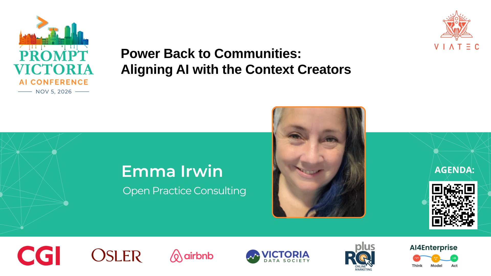

Hi. I'm Emma Irwin. I've been working in open spaces for well over twenty years, as a software engineer, program manager, technical program manager, community developer and participation lead. I've sat on pretty much every side of what it means to be successful working in the open, and I've dedicated most of my career to the empowerment of humans through openness.

I gave this talk because I think something is happening to open communities right now that we don't have good language for yet. By the end of this post I hope you'll understand three things:

1. What I mean by **open community power**
2. What the **AI alignment problem** is, in the context of open communities
3. **Who is working on this**, and how to get involved

Because, as I hope to convince you, this affects everyone who has ever used, contributed to, or released an open project.

## What I mean by open communities

When I say open communities, I mean a lot of things.

Open source itself, of course: code and everything that goes along with it. Open knowledge, so if you've contributed to Wikipedia, or released a photo under a Creative Commons license. Open data, like reusable datasets and open government data. Open science, which has democratized research through open access and open methodology. And open education. Here in Victoria we have a huge and wonderful open education community.

I deliberately left open source AI (weights, models and so on) off this slide, because this talk is about AI's relationship *with* these communities.

In the room I asked people to raise a hand if they'd used, contributed to, or shared something from any of these. Nearly every hand went up. If that's you, this post is about you, and your labour, and your work.

## Open is a dependency of modern digital infrastructure

This cartoon is usually used to talk about open source sustainability. I like to use it for something else: to show that technology depends on *humans*. As much as some shareholder-driven companies would like us to believe we can move away from that dependency, it's really not possible. Humans are the point in open communities, and they are indispensable.

## AI is trained on the labour of open communities

The dependency gets exponential when you consider how much large language models are trained on the output of open communities. The code, the documentation, the Creative Commons content, the open science papers, the open textbooks.

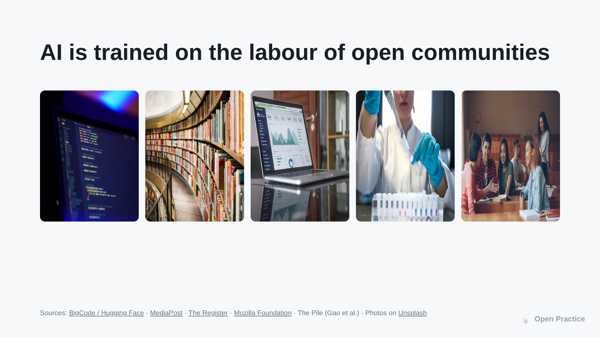

Some numbers, from specific datasets (these aren't industry-wide totals, just examples):

- **900 billion** unique tokens of code and related content in The Stack v2, used to train StarCoder2
- **3 trillion** tokens in Dolma, including Wikipedia, web content, books and code
- **28 billion** tokens of arXiv research papers in RedPajama-V1
- **1.3 trillion** tokens of educational web content in FineWeb-Edu

The big point: AI doesn't just depend on the *content* of open communities. It depends on the knowledge, expertise, governance and values that *produce* that content. These communities are creators of context. That's the phrase I keep coming back to.

## The four rights of communities

So let's talk about the rights of those context creators. After twenty-some years of doing this, here's how I'd describe them.

1. **Participation.** The right to set the conditions for participation: how contribution, leadership and recognition work.
2. **Use.** The right to set the terms for use, attribution and compensation. This is open licensing: Creative Commons, and the whole family of open source licenses.
3. **Policies and practices.** The right to define governance: decisions, workflows, permissions. This matters because what open communities publish isn't one person's output. It's the result of thoughtful governance.
4. **Behavioural norms.** The right to define and enforce expected and unacceptable behaviour. Codes of conduct have had a big influence here, and this one has always been understood as being about *human* collaboration. Which, of course, is changing.

### What those rights look like when they work

It's easy for me to talk about this in the context of the open web, because this moment with AI reminds me so much of it. The early web gave us the chance to publish, to connect with people across the planet, to do things that used to be hard or expensive. It was a really exciting time. AI has a similar feeling right now, like maybe we can cure cancer. But also...

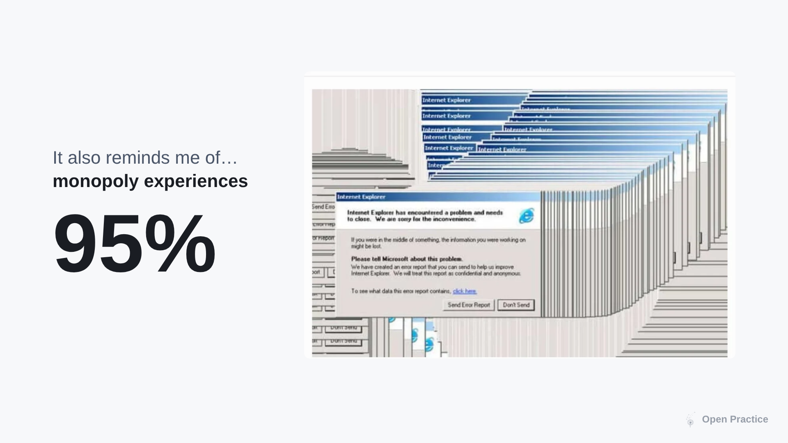

It also reminds me of the monopoly experience of Internet Explorer. At its peak IE had something like 95% of browser market share. To see the web, to see *your things* on the web, you had to use it, pop-ups and all. We all used it because it was very much the only way we could.

Skipping through a long story: a bunch of engineers, designers and, yes, lawyers came together and released the Mozilla project as an alternative. And the coolest artifact of that time is this.

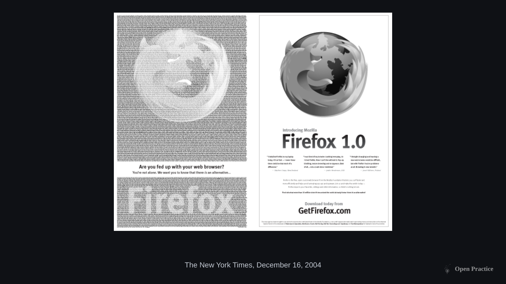

A two-page ad in the New York Times, crowdfunded by Mozilla contributors at a time before GoFundMe existed, with the names of everyone who chipped in making up the logo. For me this is the biggest moment in open source, because it created a competitor to enterprise software without having to convince the incumbent to change. And that collective action changed the market.

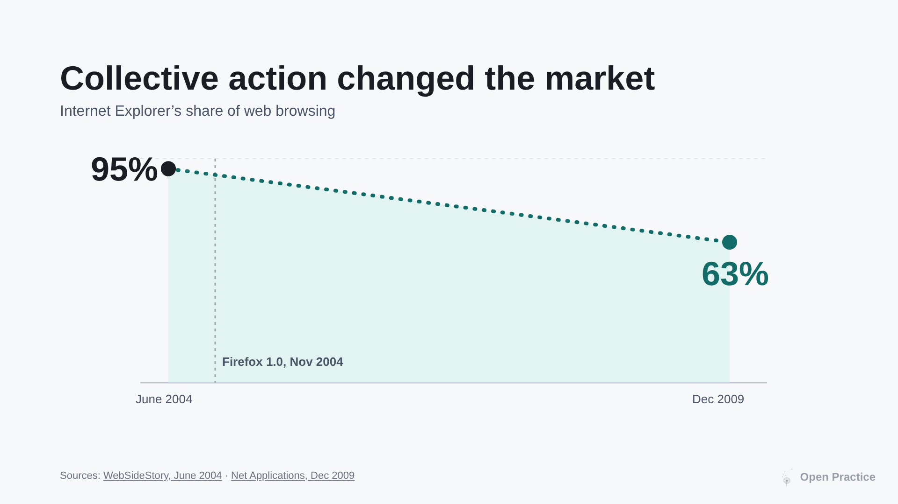

Regardless of whether corporations wanted to engage with choice and interoperability, it happened, because people decided together that it was something they wanted.

That's the four rights in practice. Mozilla defined pathways for participation (localization is still a huge part of the community), applied open licenses, built governance like module ownership, and eventually the Community Participation Guidelines. Together, we were stronger.

## The AI alignment problem

Now let's talk about the alignment problem. If you haven't come across it, it sits within the broader discipline of AI safety. (Brian Christian, who wrote a book of the same name, recently gave a talk at UVic, and I recommend the book if you want the fuller picture.)

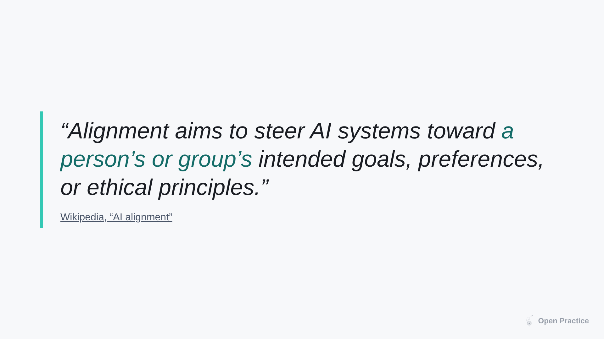

You'll often hear this summarized as "aligning AI with human values." Which, for me, raised an obvious question a couple of years ago when I was trying to work out how AI fit into what I valued for the democratization of technology.

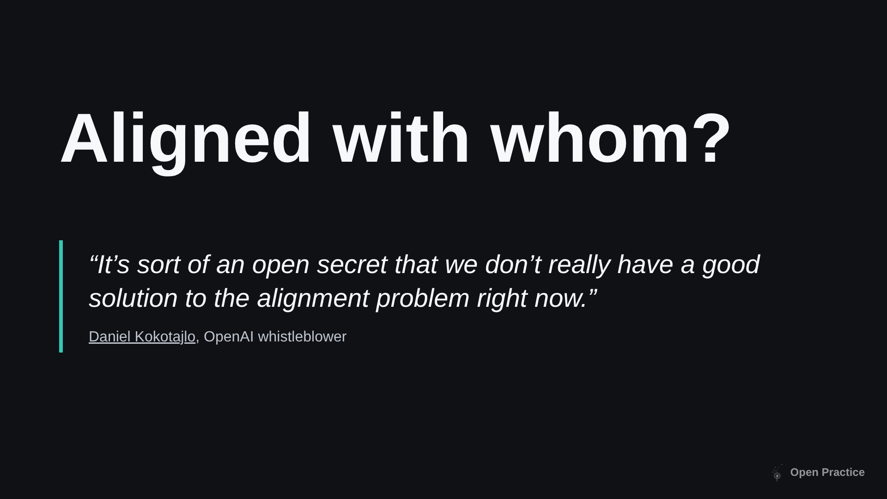

Aligned with *whom*? Whose values? Which groups? I learned quickly that my questions weren't new. People had been raising them for some time, including Daniel Kokotajlo, who left OpenAI, declined to sign the NDA and walked away from his severance in order to say out loud that we don't have a good solution to this.

Because it's hard for an outsider to evaluate a model's alignment (there's no label on the box), I started looking for the *words* labs and governments use to describe it. And I came across this line in the White House AI Action Plan.

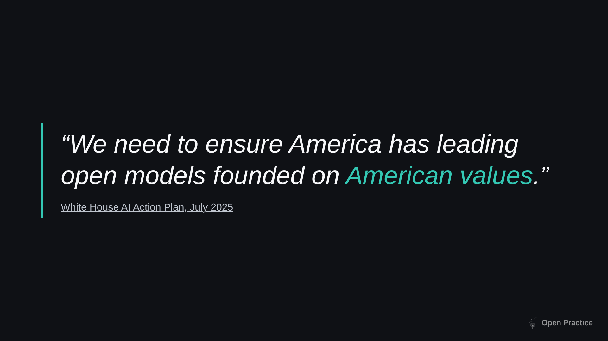

Not to be political, but I found this sentence alarming. Openness has always been a global endeavour, not a regional one. Anything labelled "open" being aligned with one government's political values of the moment is contrary to the spirit of open source. And, as a Canadian who cares about digital sovereignty, many of those values are not mine. That's one example of misalignment. Here are some more, mapped to the four rights.

- **Participation: overwhelm.** Models can now find bugs incredibly fast, but it still takes humans to fix them. Add a flood of contributions that are too much at once, irrelevant or duplicate, and maintainers who don't have time to process it all. It almost makes you want to stop. And it's increasingly hard to tell whether a contribution is from a person or from someone's agent masquerading as one.
- **Use: licences ignored.** Models are trained on open source and Creative Commons content with no attribution and no compliance with those licenses. I know this is a legal topic with lawsuits in progress, but at the end of the day a right that communities had is simply not being respected. Creating content for trillion-dollar companies is not why we work in the open.
- **Policies and practices: environment and infrastructure.** Open projects historically haven't had governance around environmental impact, but increasingly it's a stated reason for banning AI or requiring disclosure. Communities are grappling with the fact that increased productivity might also mean an increased burden on the planet.
- **Behavioural norms: reward hacking.** Agents breaking containment and invading spaces in ways that violate what humans expect. Or, closer to home, "Emma's notetaker" showing up to a call instead of Emma.

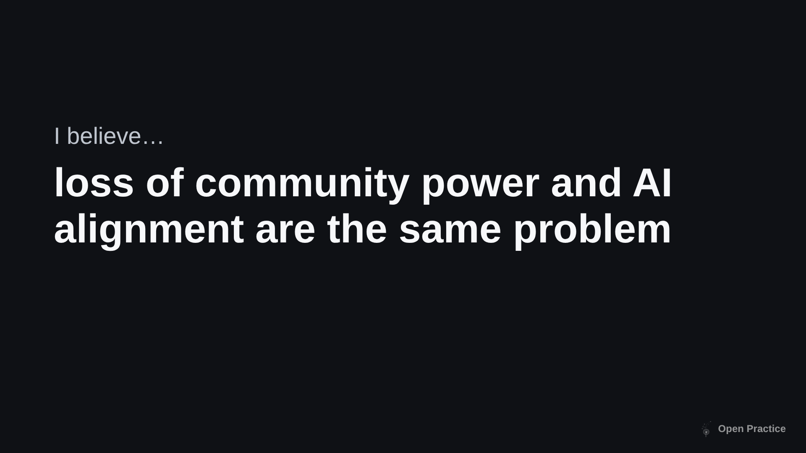

Here's where I've landed. **Loss of community power and the AI alignment problem are the same problem.** The loss of community power *is* misalignment. And the answer to "aligned with whom?" is: open communities.

## Who is working on this

Two places I spend my time: the [CHAOSS AI Alignment Working Group](https://github.com/chaoss/wg-ai-alignment), which I co-chair with Coraline Ada Ehmke (Organization for Ethical Source) and Justin W. Flory (Fedora), and the [Organization for Ethical Source](https://ethicalsource.dev/), home of the Contributor Covenant, the most widely used code of conduct in open source.

The question we're asking is simple to state: how do we align AI with the values of the communities it depends on and consumes? What is the lever, the way Firefox 1.0 was a lever?

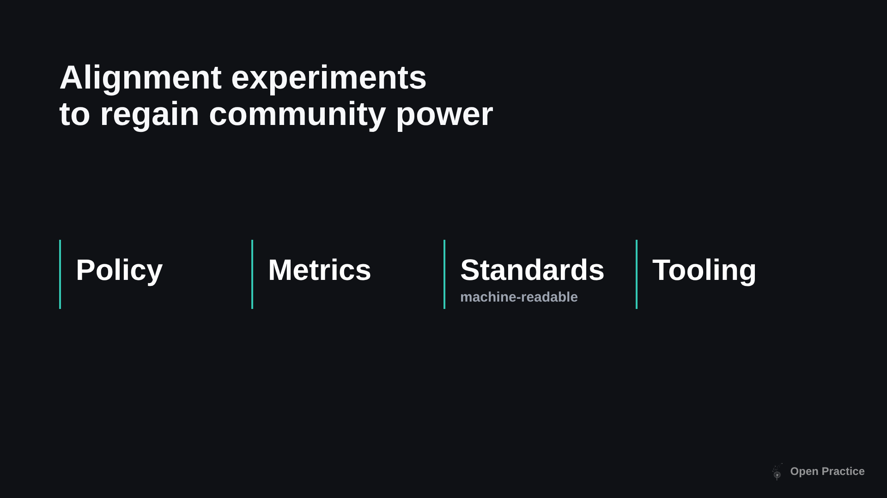

From what we've observed, open communities are tackling misalignment in four ways, even if they wouldn't call it that: **policy**, **metrics**, **machine-readable standards** and **tooling**. Let me go through each.

### Metrics: what 200+ AI policies tell us

In CHAOSS we recently released two metrics models. A metrics model is a grouping of metrics that together answer one question.

The first, **Community Governed Use**, asks: how clear and compliant is a community's governance of AI use? We've been collecting AI policies from open projects for about a year, and we applied the Policy Specificity metric to a cohort of more than 200 of them. Here's what we found.

**First, the policies are hard to find.**

There's no standard place and no standard format. Thirty-seven file names were used by exactly one project each. It's an extension of a familiar open source problem, that it's hard to understand how to participate in a project, and if people can't find the policy, machines can't either.

**Second, policies govern one set of things, and are motivated by another.**

Unsurprisingly for open source projects, most policies are about code contributions, moderation, content and documentation, and agentic use. But when we looked at the *rationale* (blog posts announcing a policy, preambles in files) a different set of concerns showed up. 42% of rationale mentions cited environmental impact. Infrastructure strain and data use for training followed. Almost none of those concerns appear in the policies themselves. I think that signals a gap: people know what they're worried about, but there's no wording in a policy that can enforce carbon spend, so it doesn't make it in.

**Third, a lot of projects are just saying no.**

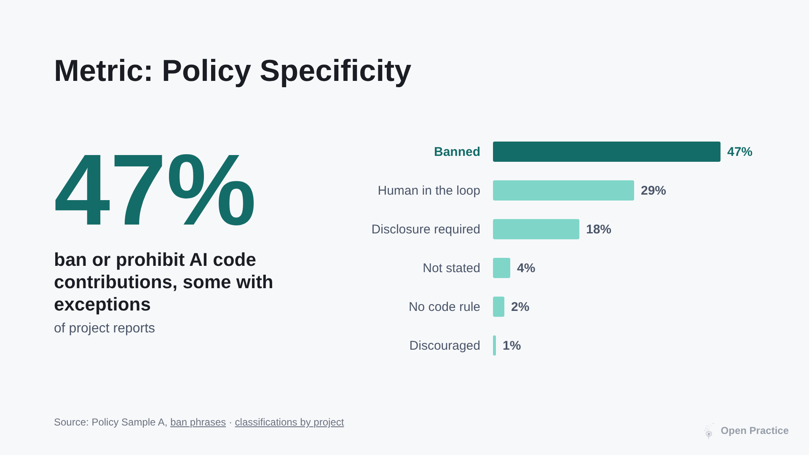

I went back and double-checked this one. 47% of the projects in our sample ban or prohibit AI code contributions, some with exceptions. That may partly be because the first projects out of the gate with policies are the ones banning AI. My guess is it also reflects a kind of helplessness: people care about the environment and infrastructure strain, there's no policy language that can address it, so the answer is simply "banned."

**Fourth, nobody has settled.** We also tried the Policy Change metric, tracking revisions over time.

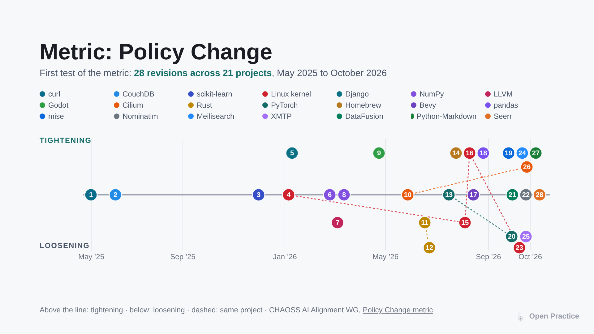

Most policies are first drafts, so there's little change to track yet. Where we did see change, projects swung back and forth between permissive and restrictive. The Linux kernel, for example, went both ways. No trend yet. What this tells me is that everyone is still figuring it out, and the debate spills out onto social media.

Just because a policy exists doesn't mean it's the last one, or that people are happy with it.

### Metrics: can a community talk back to a model builder?

The second metrics model, **Community Aligned Training**, asks: can a community give feedback to a model builder and see its impact?

It doesn't seem radical that communities whose work AI depends on massively would have some involvement in the alignment process. So we looked at how alignment actually happens today.

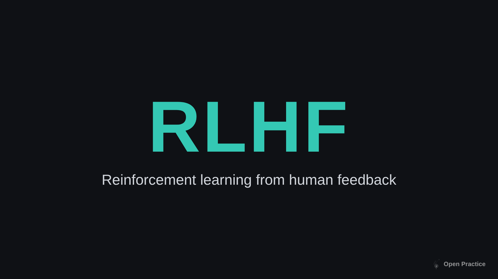

In RLHF, the model writes several answers, people rank them, a reward model learns those preferences, and the model is tuned toward what ranked well. (If a chatbot has ever asked you which of two answers you prefer, you've participated.) So who ranks? Company staff and paid contractors, via platforms like Upwork and Scale AI. InstructGPT used around 40 contractors. Increasingly it's AI feedback too, guided by company principles. Not the communities whose work trained the model. That is scoped to the business, and that's a misalignment.

So we built metrics around a process that doesn't exist yet: what would it look like if communities could participate in a way that is also valuable to the model builder? What governance would the community need? Who is accountable for feedback? What do efficiency and effectiveness look like? We're not blind to the fact that there has to be a value exchange.

Then we put out a call. We figured open model builders would be most interested in working with communities, and we had open communities ready to go.

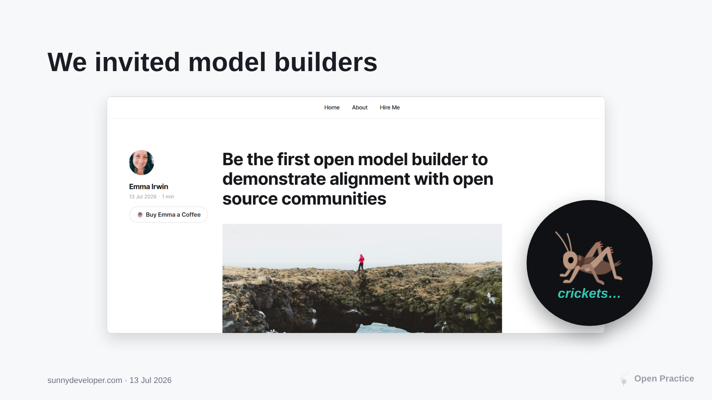

Crickets. Despite direct outreach, we couldn't get a single model builder interested. Maybe I was too much of an optimist. The private feedback I've had since is instructive, though: creating a feedback channel for a specific community sets a *precedent*, and if the lab stops or gets it wrong, that's a brand risk. There may also be legal risk if community feedback isn't paid the way contractor feedback is. These are real, unexplored business questions that CHAOSS and open communities can't solve alone. Someone on the model builder side has to lower the drawbridge.

Which brings us back to the problem. We don't have a lever. There is nothing, yet, that makes corporations *want* to do this.

### Standards: machine-readable preferences

So let's look at how people are trying to build levers.

There's a cluster of work on machine-readable ways for creators to assert preferences about attribution, licensing and compensation in their relationship with AI. The one I'll draw attention to is Creative Commons Signals, which is currently paused (not stopped). Here's what CC said about why:

I think this is true. It's the same story as our feedback metric: it asks model builders and scrapers to engage, and there is no lever that makes them. A lot of smart people are working on it, and it's worth watching.

### Tooling: detect, disclose, measure

From what I've seen, the tooling being built falls into three categories.

Under **detect**, the CHAOSS disclosure tool gathers AI disclosure signals from contributions, and it's now in Homebrew. Under **disclose**, folks are working on new attribution standards for saying what AI did and how much of it went in. Under **measure**, Carbon Guard blocks CI runs when the grid is carbon-heavy. These are all looking for the same thing: mechanisms of enforcement for the things projects say they want.

Two more projects worth watching. [Satyrn](https://satyrn.ai/), which Carol Willing shared with me from the Python community, is one community thoughtfully building its own AI on its own terms: which open-weight models respect the community's values, what people can actually run on their laptops, how everyone can participate.

And [asago](https://asago.ai/), a newer community project with an enterprise audience: it ingests a governance policy, maps it to recognised AI risk frameworks, and generates tests and controls that show whether the policy is being enforced.

I like that we're getting down to the level of enforcement. We're not there yet, of course. We'll know we're there when those with the power start trying to work with us.

## ETHOS: building the lever together

What we still lack is an ecosystem-level, collective-action effort to influence model builders. So far we're mostly building walls. That's why I'm so excited about something we're launching now at the Organization for Ethical Source: a new working group called the **ETHOS Protocol**, the Ethical Tooling Harness for Open Source.

It's led by the same three co-chairs as the CHAOSS working group, and it takes everything we've learned from the metrics and points it at an industry-standard lever for enforcing alignment. The idea isn't that different from the Contributor Covenant:

1. **Ecosystem alignment.** Agree, as an ecosystem, on the shared rights and expectations communities have of AI. We have early instincts, ideas and data on what those categories are.
2. **Community adoption.** Communities adopt and adapt the standard.
3. **Harness.** Enforce at the harness level. A harness reinforces the choices available in a space, and enterprises already use them to enforce compliance with organizational policy.
4. **Collective influence.** Because we're working together, communities can demand that AI builders respect their terms.

That's the collective action that changed the market in the Firefox story. Last time, about $10,000 paid for a newspaper ad. This time it's a policy, a metric, and a seat at the table.

## How to get involved

- **CHAOSS AI Alignment Working Group.** We're always around and excited when someone new joins: [github.com/chaoss/wg-ai-alignment](https://github.com/chaoss/wg-ai-alignment)
- **ETHOS Protocol.** Our first meeting is November 20. Sign up through the [Organization for Ethical Source](https://ethicalsource.dev/) to join the Slack and get the invites. We're looking for people from across the open source ecosystem, builders and critics alike, people who've built protocols, open model builders, and folks who've worked with harnesses. If you're interested in an open harness partnership, let's talk.
- **Open Practice** is me. I do this work mostly because I care, and I'd love for someone to hire me to do it. If you have a problem to solve or want to collaborate on openness in the AI era, get in touch at [sunnydeveloper.com](https://sunnydeveloper.com/).

The talk contained a lot of information, but the message is short. The four rights of communities are in disarray because of AI. The AI alignment problem is the right way to scope it. And collective action, building a new lever, is the way to solve it.

Power back to communities.

---

*Sources and credits: XKCD 2347 by Randall Munroe (CC BY-NC 2.5). Firefox 1.0 advertisement, The New York Times, December 16, 2004. Browser share figures from WebSideStory (June 2004) and Net Applications (December 2009). Alignment definition from Wikipedia. Daniel Kokotajlo quote via podcast interview. White House AI Action Plan, July 2025. Policy data from the CHAOSS AI Use Specificity analysis, Policy Sample A. Creative Commons, "Update on CC Signals: What Changed and Why," April 23, 2026. Photos on Unsplash by Mohammad Rahmani, Susan Q Yin, Carlos Muza, Julia Koblitz and Vitaly Gariev.*
